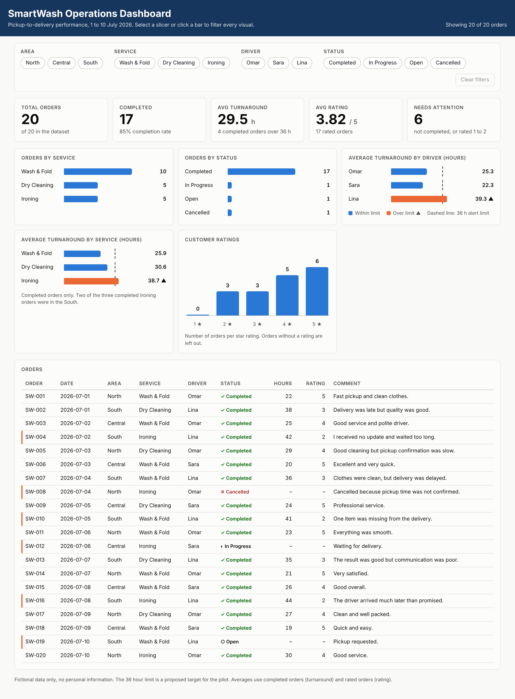

# SmartWash Laundry: Digital Transformation Capstone

A capstone project that advises a traditional laundry company on choosing a genuine digital transformation and redesigning its pickup-to-delivery journey.

**Author:** Ghadah Falah Bani Ali

## Project summary

Three initiatives were evaluated:

| Initiative | Type | Decision |
|---|---|---|
| A. Scan paper receipts | Digitization | Rejected |
| B. Buy tablets for employees | Digital improvement | Rejected |
| **C. Digital pickup and delivery service** | **Digital transformation** | **Selected** |

Initiative C was selected because it redesigns the end-to-end customer journey, uses technology and data, automates the process, and creates measurable customer and business value.

## What is inside the report

1. The three initiatives and the selection decision
2. 5W2H analysis
3. Current and improved customer journey (with the moment of truth)
4. Automation / RPA design (Google Forms, Google Sheets, Make.com, email) and business rules
5. Data analysis of a fictional 20-order dataset: KPIs, three charts, and business conclusions
6. AI-assisted analysis of customer feedback
7. Final recommendations and success measure

## Key findings

- 20 orders: 17 completed, 1 open, 1 in progress, 1 cancelled
- Average turnaround: 29.5 hours; average rating: 3.82 / 5
- Wash & Fold is the most requested service (50% of orders)
- The South area (driver Lina) has the slowest turnaround (39.3 hours) and the lowest rating (2.5 / 5)

## Files

| File | Description |
|---|---|
| `SmartWash DigitalTransformation.docx` | The full report (Word) |
| `SmartWash_Presentation.pdf` | slide presentation summarizing the decision, journey, automation, data findings, and recommendations |
| `SmartWash_Dashboard.html` | Interactive dashboard (download and open in a browser) |
| `README.md` | This file |

## Notes

- All data in this project is fictional. No real personal or sensitive information is included.
- Prototype tools: Google Forms, Google Sheets, Make.com, and email (or a clearly documented process design).
